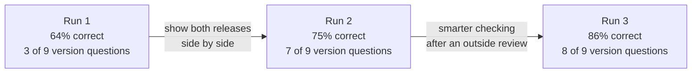
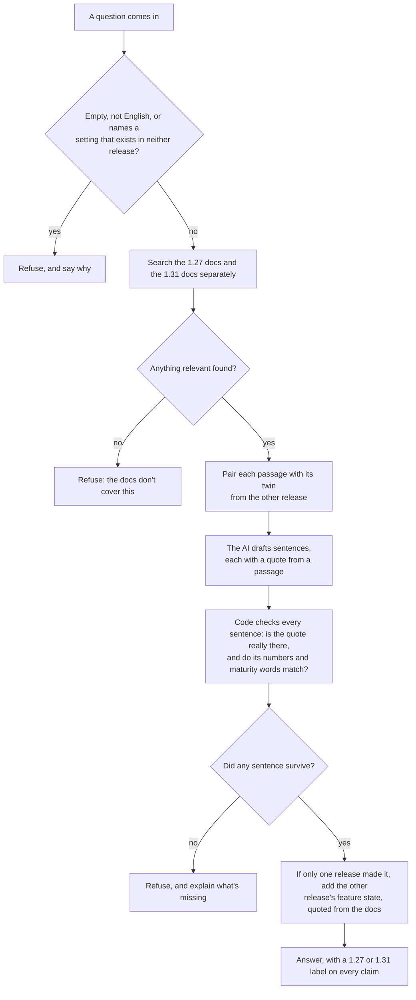

# Kubernetes docs assistant (1.27 vs 1.31)

An assistant that answers questions about Kubernetes using only the official
documentation, from two releases. It shows exactly where every claim came from,
says "the docs don't cover this" instead of guessing, and points out when the two
releases disagree.

## In 60 seconds

**The problem.** Company chatbots over product manuals look great in a demo, then
fail in a quieter way: they answer questions the manual never covers, or answer
from an older version of the manual, and they sound sure of themselves. People
forgive "I don't know". They don't forgive a confident wrong answer.

**What I built.** Picture a careful librarian with two editions of the same
manual. Ask a question, and the librarian looks it up in both editions, opens the
matching pages side by side, and answers only with sentences it can point to, word
for word. If it can't find support, it says so.

**How well it works**, measured on 36 questions I wrote and checked by hand:

| | Result |
|---|---|
| Correct answers | **86%** (31 of 36) |
| Questions it should refuse, refused | **100%** (11 of 11) |
| Quotes that match the source exactly | **100%** |
| Questions where the releases disagree, both named | **8 of 9** |
| Good questions wrongly refused | 8% |

**How it got there.** Three measured rounds, each one fixing what the previous
round's mistakes showed:



Every question that should have been refused was refused in all three runs.

## How an answer is made



The key idea: **the AI writes a draft, but plain code decides what you see.** That's
why every quote in an answer is guaranteed to be an exact copy of the documentation.

## Run it

**One command with Docker.** Unzip, then from the project folder:

```bash
LLM_API_KEY=your-groq-key docker compose up --build
```

The first build takes 10–20 minutes, because it builds the search index inside the
image. Then open **http://localhost:8080**. A free key comes from console.groq.com;
you can also put it in a `.env` file instead.

**Without Docker** you need Python 3.12 and the same key:

```bash
python3.12 -m venv .venv && source .venv/bin/activate
pip install torch==2.15.0 --index-url https://download.pytorch.org/whl/cpu
make setup
cp .env.example .env      # add your key to LLM_API_KEY
make ingest               # builds the search index (~10 min on a laptop CPU)
make serve                # http://localhost:8080
```

The web page shows each claim with a 1.27 or 1.31 marker; click one to see the
source passage with the quoted words highlighted. The API itself:

```bash
curl -s localhost:8080/ask -H 'content-type: application/json' \
  -d '{"question": "How many minor versions may the kubelet lag behind kube-apiserver?"}'
```

Add `"version": "1.27"` or `"1.31"` to search only one release.

| Command | What it does |
|---|---|
| `make eval` | Runs my question set and writes `eval_report.json` |
| `make recall` | Measures search on its own, for each search mode |
| `make smoke` | Runs the brief's edge cases against a running server |
| `make check` | Lint, type checks and tests |

All settings are environment variables (see `.env.example`), and dependencies are
pinned to the versions the numbers here were measured with.

## The documents

From `github.com/kubernetes/website`, fetched 2026-11-25:

| Release | Branch | Commit | Pages |
|---|---|---|---|
| 1.27 | `release-1.27` | `f173f35` | 335 |
| 1.31 | `release-1.31` | `11f92a0` | 357 |

From each branch I took `content/en/docs/concepts/`, `content/en/docs/tasks/` and
`content/en/releases/version-skew-policy.md`. For 1.31 I also read the
feature-gate files, but only to look up whether a feature is alpha, beta or
stable; they aren't indexed as pages. The corpus is committed in `corpus/`, and
`corpus/MANIFEST.json` records the full commit hashes. `make fetch` pulls the same
paths again.

## The choices, and why

**Splitting the docs.** Each page is split at its headings, because that's how
these docs are organised: one heading, one topic. Before splitting, Hugo's template
tags are turned into real text using each release's own version number. Without
that step, the version skew page reads the same in both releases, which is exactly
the place they differ.

**Searching.** Each release is searched on its own, so one can't crowd the other
out of the results. Keyword search catches exact names like `--max-pods`; semantic
search catches meaning. Combined, they found the right page for every question.

**Comparing releases.** This mattered most. Take the kubelet question: 1.27 says it
may trail the API server by two versions, 1.31 says three. My first run often showed
the AI only one of those pages. Now every passage brings its twin, the same section
from the other release, so the AI always sees both. And if an answer still covers
only one release, code reads the other release's `FEATURE STATE` line (alpha, beta,
stable) and adds it, quoted and cited. Nothing in that step is generated, so it
can't be invented.

**Checking each sentence.** A sentence survives only if its quote really is in the
cited passage, and every number and maturity word it states is there too. If the
AI's quote is nearly but not exactly word for word (a dropped word, two lines
joined), it's aligned to the closest real text, but only when at least 90% similar
and stating the same numbers and stages. The quote you see is always the
documentation's own text.

**When it refuses.** Three checks:
- *Unknown settings.* A `--flag` or feature gate that appears in neither release is
  refused straight away. It's checked against every term in the docs, not just what
  search happened to find.
- *Nothing relevant.* If the best search score is under 0.05, it refuses. I kept this
  low on purpose: off-topic questions score near 0, but tricky unanswerable ones
  score almost as high as real ones (0.92 against 0.99). No threshold separates them
  without refusing good questions, so the next check handles them.
- *Nothing verified.* If no drafted sentence can be backed by a quote, the answer
  becomes a refusal that explains what was missing.

**What I count as a hallucination:** any answer that isn't a refusal and is wrong,
either because it answered something it should have refused, or because it missed a
fact the expected answer requires. The report keeps the two parts separate. A
refusal never counts as a hallucination; it counts as a false refusal, so both kinds
of mistake stay visible.

More detail: [architecture](docs/architecture.md), [evaluation method](docs/evaluation.md),
[decisions](docs/decisions.md).

## Results in detail

Measured on my own laptop: HP Pavilion 14, 12th-gen Intel, 8 GB RAM, no GPU. The AI
model was `gpt-oss-120b` on Groq's free tier. Reproduce with `make ingest && make eval`.

| | Test (36) | Practice set (10) | Written after run 1 (10) |
|---|---|---|---|
| Correct answers | **86.1%** | 80.0% | 100% |
| Unanswerable or trick questions refused | **100%** (11 of 11) | 100% (3 of 3) | 100% (3 of 3) |
| Good questions wrongly refused | **8%** | 14% | 0% |
| Hallucination rate (all incomplete; none answered what it should refuse) | 8.3% | 10.0% | 0% |
| Version questions with both releases cited | **8 of 9** | 2 of 2 | 6 of 6 |
| Quotes that exactly match the source | **100%** | 100% | 100% |
| Right page found in the top 5 (search only) | **100%** | 100% | 100% |

**How answers are scored.** Automatically, with no AI judge. A question that should be
refused counts as correct only if it's refused with no citations. An answerable one
counts only if the answer contains the expected facts, and for version questions,
names and cites both releases. Details in [docs/evaluation.md](docs/evaluation.md).

**Speed.** Answers usually take 2–5 seconds. The slowest 5% took 17 seconds, which
includes waiting on the free tier's rate limit (`eval/eval_report_run2_live.json`).

**Getting my exact numbers.** The AI's replies from my run are saved in
`eval/.llm_cache/`, so `make eval` replays them and reproduces every number above
exactly, with no API key needed. Search, checking and scoring still run live on your
machine; only the timing differs, because no AI calls are made. Delete that folder to
run fresh with your own key, and expect small differences, because the AI model
isn't perfectly deterministic.

### Being upfront about the three runs

| Test set | Run 1 | Run 2 | Run 3 |
|---|---|---|---|
| Correct answers | 63.9% | 75.0% | **86.1%** |
| Version questions | 3/9 | 7/9 | **8/9** |
| Good questions wrongly refused | 28% | 24% | **8%** |
| Unanswerable refused | 11/11 | 11/11 | 11/11 |

- **Run 1 to 2:** design changes after reading the first run's traces (twin passages
  from both releases, a better support check). I wrote the 10 "after run 1" questions
  *before* run 2, to check the fixes held up; they scored 80% then.
- **Run 2 to 3:** changes after an outside review of run 2 (quote alignment, adding the
  other release's feature state in code, a narrower unknown-setting check, and
  switching off the NLI check, below). Run 3 uses **exactly the same AI replies as run
  2**; only the checking afterwards changed. Since these changes came after seeing
  failures on every set, none of my sets is unseen any more. Your held-out questions
  are the real test.

Runs 1 and 2 are kept in `eval/eval_report_v1_baseline.json` and
`eval/eval_report_run2_live.json`.

### The NLI experiment, and how I decided

The NLI model was a second checker on every sentence. I replayed the same AI replies
with it on and off:

| Test set | NLI on | NLI off |
|---|---|---|
| Correct answers | 77.8% | 86.1% |
| Good questions wrongly refused | 24% | 8% |
| Answered but incomplete | 2 | 3 |
| Answered what should be refused | 0 | 0 |

Before measuring, my rule was to keep NLI only if it stopped wrong answers getting
through. Taken literally, it did: one more incomplete answer appears without it
(T-35). I then read that answer. It's correct (create an `EncryptionConfiguration`,
restart the API server) and fully quoted; it only leaves out the flag name the
scoring looks for. So NLI's only real effect was refusing good answers, and it's now
removed from the code. I'm saying this plainly because
the final call was made after reading that answer, not by the rule alone.

**Search on its own** (`make recall`): keyword search alone and semantic search alone
each found 96% of the right pages; combined, 100%. The reranker added no recall, but
it orders the passages the AI sees and provides the score behind the "nothing
relevant" check. My first reranker took 18.8 seconds per search on this laptop, so I
switched to a smaller one (1.2 seconds).

### The three answers it gets most confidently wrong

1. **T-07, KMS v1.** It answers for 1.27 (use KMS v2 for better performance) but never
   says that 1.31 deprecated KMS v1, the one fact that matters. The 1.31 sentence
   failed its check, and the twin section had no different feature state for code to add.
2. **T-35, encryption at rest.** Correct and quoted, but it doesn't name
   `--encryption-provider-config`, which the expected answer requires.
3. **T-36, pinning a Pod to a node.** Right in substance (label the node, use
   `nodeSelector`), but it cites the DaemonSet page and doesn't say `kubectl label`. I
   left my expected answer as it was rather than change it after seeing the result.

Search found the right page every time, so every remaining mistake comes from the
answer step, not from search.

## Features

Everything the brief asks for, plus:
- Combined keyword and semantic search, measured mode by mode
- A reranker, with an honest note that it didn't add recall
- A `version` option to search only one release
- A second question set written after seeing my own failures, reported separately
- A web page where every citation opens its source passage

**Reliability.** `/readyz` reports whether the index and models actually loaded, and
the Docker health check uses it. If the main AI model keeps failing, the service
retries once with a smaller fallback model (`LLM_FALLBACK_MODEL`; switched off during
`make eval`, so the numbers come from one model). Each request writes one log line
with its outcome and timing.

Every request gets a proper response, never a crash: an empty question, 4,000
characters, another language, broken JSON or the AI being unavailable all return the
normal format. Rebuilding the index gives identical files every time.

## Known issues

- **One-sided version answers can still happen.** T-07 covers only 1.27. Code fills in
  the other release only when its twin section states a different feature state.
- **Absence statements have no citation.** A line like "The 1.27 documentation
  excerpts do not cover this" carries no `[chunk_id]`, because there's no passage to
  quote for something missing. Only that fixed form is allowed through without one.
- **My version questions lean on feature-state changes.** 8 of 9 are maturity
  differences found by comparing `FEATURE STATE` lines, and T-01 is the brief's own
  example. Questions about changed defaults, removed flags and renamed fields would
  test more.
- **Scoring is keyword-based.** It's reproducible, but stricter than a human reader
  (T-35, T-36).
- **Example files aren't included.** Some task pages point to YAML files I didn't
  ingest.
- **Free-tier limits.** Groq allows only about one full live run per day, which is
  one reason the recorded replies are included.

## Next steps I didn't get to

These came out of reviewing run 2, and need fresh AI calls, so they wait on the free
tier's daily quota:
- Show the AI whole passages instead of the first 1,000 characters (T-28's answer sits
  past that cut).
- When every sentence fails its check on a strongly matched question, ask the AI once
  more, telling it which quotes didn't match.
- Add version questions found by reading: changed defaults, removed flags, renamed fields.
- Commit a fresh live run, so speed and accuracy come from the same report.

## What I left out

- **An AI judge for scoring.** Keyword checks are stricter, but anyone can reproduce
  my numbers exactly.
- **The rest of the docs site.** Two bounded sections were enough to find real
  disagreements between releases.
- **A polished front end.** The page is one HTML file; my time went into making the
  answers right.

How I used AI on this project: [AI_USAGE.md](AI_USAGE.md).
