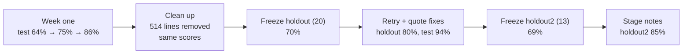
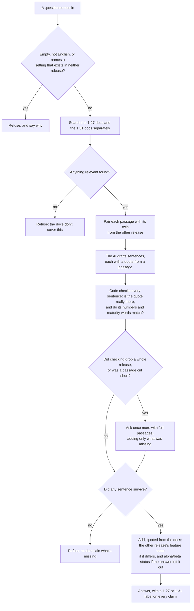

# Kubernetes docs assistant (1.27 vs 1.31)

An assistant that answers questions about Kubernetes using only the official
documentation, from two releases. It shows exactly where every claim came from,
says "the docs don't cover this" instead of guessing, and points out when the two
releases disagree.

## In 60 seconds

**The problem.** Company chatbots over product manuals look great in a demo, then
fail in a quieter way: they answer questions the manual never covers, or answer
from an older version of the manual, and they sound sure of themselves. People
forgive "I don't know". They don't forgive a confident wrong answer.

**What I built.** Picture a careful librarian with two editions of the same
manual. Ask a question, and the librarian looks it up in both editions, opens the
matching pages side by side, and answers only with sentences it can point to, word
for word. If it can't find support, it says so.

**How well it works.** The headline is the question set the system had never seen
when its last change was made:

| Unseen questions (holdout2, 13) | Result |
|---|---|
| Correct answers | **84.6%** (11 of 13) |
| Questions it should refuse, refused | **100%** (3 of 3) |
| Version questions with both releases named | **3 of 3** |
| Quotes that match the source exactly | **100%** |
| Good questions wrongly refused | **0%** |

On every set, including the 36 test questions from week one (now **94.4%**, 9 of 9
version questions), nothing that should be refused was answered, and no good
question was refused.
Where it still falls short: some answers are correct but leave out a detail, and
one (G-05) said more than its quote supports. Both are explained below.

**How it got there.** Week one built and measured it in three runs. Week two, after
a first review, removed what didn't earn its place and fixed what the misses showed,
measuring before and after on questions frozen first:



## How an answer is made



The key idea: **the AI writes a draft, but plain code decides what you see.** That's
why every quote in an answer is guaranteed to be an exact copy of the documentation.

## Run it

**One command with Docker.** Unzip, then from the project folder:

```bash
LLM_API_KEY=your-groq-key docker compose up --build
```

The first build takes 10–20 minutes, because it builds the search index inside the
image. Then open **http://localhost:8080**. A free key comes from console.groq.com;
you can also put it in a `.env` file instead.

**Without Docker** you need Python 3.12 and the same key:

```bash
python3.12 -m venv .venv && source .venv/bin/activate
pip install torch==2.15.0 --index-url https://download.pytorch.org/whl/cpu
make setup
cp .env.example .env      # add your key to LLM_API_KEY
make ingest               # builds the search index (~10 min on a laptop CPU)
make serve                # http://localhost:8080
```

The web page shows each claim with a 1.27 or 1.31 marker; click one to see the
source passage with the quoted words highlighted. The API itself:

```bash
curl -s localhost:8080/ask -H 'content-type: application/json' \
  -d '{"question": "How many minor versions may the kubelet lag behind kube-apiserver?"}'
```

Add `"version": "1.27"` or `"1.31"` to search only one release.

| Command | What it does |
|---|---|
| `make eval` | Runs all four question sets and writes `eval_report.json` |
| `make recall` | Measures search on its own, for each search mode |
| `make smoke` | Runs the brief's edge cases against a running server |
| `make check` | Lint, type checks and 80 tests (also runs on GitHub on every push) |

All settings are environment variables (see `.env.example`), and dependencies are
pinned to the versions the numbers here were measured with.

## The documents

From `github.com/kubernetes/website`, fetched 2026-11-25:

| Release | Branch | Commit | Pages |
|---|---|---|---|
| 1.27 | `release-1.27` | `f173f35` | 335 |
| 1.31 | `release-1.31` | `11f92a0` | 357 |

From each branch I took `content/en/docs/concepts/`, `content/en/docs/tasks/` and
`content/en/releases/version-skew-policy.md`. For 1.31 I also read the
feature-gate files, but only to look up whether a feature is alpha, beta or
stable; they aren't indexed as pages. The corpus is committed in `corpus/`, and
`corpus/MANIFEST.json` records the full commit hashes. `make fetch` pulls the same
paths again.

## The choices, and why

**Splitting the docs.** Each page is split at its headings, because that's how
these docs are organised: one heading, one topic. Before splitting, Hugo's template
tags are turned into real text using each release's own version number. Without
that step, the version skew page reads the same in both releases, which is exactly
the place they differ.

**Searching.** Each release is searched on its own, so one can't crowd the other
out of the results. Keyword search catches exact names like `--max-pods`; semantic
search catches meaning. Combined, they found the right page for every question.

**Comparing releases.** This mattered most. Take the kubelet question: 1.27 says it
may trail the API server by two versions, 1.31 says three. My first run often showed
the AI only one of those pages. Now every passage brings its twin, the same section
from the other release, so the AI always sees both. And if an answer still covers
only one release, code reads the other release's `FEATURE STATE` line (alpha, beta,
stable) and adds it, quoted and cited. Nothing in that step is generated, so it
can't be invented.

**Checking each sentence.** A sentence survives only if its quote really is in the
cited passage, and every number and maturity word it states is there too. If the
AI's quote is nearly but not exactly word for word (a dropped word, two lines
joined), it's aligned to the closest real text, but only when at least 90% similar
and stating the same numbers and stages. If it glued two passages together with
"..." or swapped two sentences, the longest piece that is found word for word is
kept. The quote you see is always the documentation's own text. And a sentence may
only name a release (1.27, 1.31) that it cites or that its quoted text mentions, so
a 1.27 passage can't be used to say something about 1.31.

**A second chance, without losing anything.** Sometimes checking throws away a
right answer: the passage the AI saw was cut at 1,000 characters (T-28's answer sat
just past that), or a quote was copied loosely. When checking drops every sentence
about a release, or the AI says "not answerable" about a passage that was cut short,
it asks once more, with the full passages and a list of the quotes that didn't match.
The second answer is merged in, never swapped in: everything the first one kept stays.

**Saying when a feature isn't finished.** Answers about a feature often explained
what it does but not that it's alpha or beta, which is the first thing you need to
know before relying on it. If a cited section is marked alpha, beta or deprecated and
the answer doesn't say so, code adds that line, quoted and cited.

**Never hanging.** `/ask` gives up after 30 seconds (`REQUEST_TIMEOUT_S`) and returns
a normal refusal, so a slow or rate-limited model can't hold a request open. Each
request logs how long search, the AI and the retry took.

**When it refuses.** Three checks:
- *Unknown settings.* A `--flag` or feature gate that appears in neither release is
  refused straight away. It's checked against every term in the docs, not just what
  search happened to find.
- *Nothing relevant.* If the best search score is under 0.05, it refuses. I kept this
  low on purpose: off-topic questions score near 0, but tricky unanswerable ones
  score almost as high as real ones (0.92 against 0.99). No threshold separates them
  without refusing good questions, so the next check handles them.
- *Nothing verified.* If no drafted sentence can be backed by a quote, the answer
  becomes a refusal that explains what was missing.

**What I count as a hallucination:** any answer that isn't a refusal and is wrong,
either because it answered something it should have refused, or because it missed a
fact the expected answer requires. The report keeps the two parts separate. A
refusal never counts as a hallucination; it counts as a false refusal, so both kinds
of mistake stay visible.

More detail: [architecture](docs/architecture.md), [evaluation method](docs/evaluation.md),
[decisions](docs/decisions.md).

## Results in detail

Measured on my own laptop: HP Pavilion 14, 12th-gen Intel, 8 GB RAM, no GPU. The AI
model was `gpt-oss-120b` on Groq's free tier. Reproduce with `make ingest && make eval`.

| | Holdout2 (13) | Holdout (20) | Test (36) | Practice (20) |
|---|---|---|---|---|
| Still unseen? | **Yes** | Until the stage-note fix | No, tuned on | No, tuned on |
| Correct answers | **84.6%** | 95.0% | 94.4% | 95.0% |
| Unanswerable or trick questions refused | **3 of 3** | 5 of 5 | 11 of 11 | 5 of 5 |
| Good questions wrongly refused | **0%** | 0% | 0% | 0% |
| Hallucination rate (all incomplete; none answered what it should refuse) | 15.4% | 5.0% | 5.6% | 5.0% |
| Version questions with both releases cited | **3 of 3** | 5 of 5 | 9 of 9 | 8 of 8 |
| Quotes that exactly match the source | **100%** | 100% | 100% | 100% |
| Right page found in the top 5 (search only) | **100%** | 100% | 100% | 100% |

**The question sets.** Test (36) was written before the first run. Practice (20) is
the week-one practice set plus 10 questions written after run 1. In week two I
froze two holdout sets before changing code: holdout (20) before the retry and quote
fixes, holdout2 (13) before the stage-note fix. Claude drafted both from the docs; I
checked every expected answer against its source line before freezing them (commits
`3e8ada7` and `ec41e6e`). See
[docs/evaluation.md](docs/evaluation.md).

**How answers are scored.** Automatically, with no AI judge. A question that should be
refused counts as correct only if it's refused with no citations. An answerable one
counts only if the answer contains the expected facts, and for version questions,
names and cites both releases.

**Speed.** With the AI's replies replayed, a question takes about 1.5 seconds, nearly
all of it search and reranking on the CPU. With live AI calls, answers usually take
2–5 seconds; the slowest 5% took 11 seconds in the live week-two run, from the extra
retry call and free-tier rate limits. `/ask` never waits more than 30 seconds.

**Getting my exact numbers.** The AI's replies from my runs are saved in
`eval/.llm_cache/`, so `make eval` replays them and reproduces every number above
exactly, with no API key needed. Search, checking and scoring still run live on your
machine. Delete that folder to run fresh with your own key, and expect small
differences, because the AI model isn't perfectly deterministic.

### Being upfront about every run

| | Holdout2 | Holdout | Test |
|---|---|---|---|
| Week one, run 1 / 2 / 3 | – | – | 63.9% / 75.0% / 86.1% |
| Week two, after clean-up (same behaviour) | – | 70.0% | 86.1% |
| After retry and quote fixes | 69.2% | 80.0% | 94.4% |
| After stage notes | **84.6%** | 95.0% | 94.4% |

- **Week one:** run 1 to 2 changed the design after reading traces (twin passages
  from both releases); run 2 to 3 changed only the checking, after an outside review.
- **Clean-up** removed the NLI checker, a benchmark script and unused report fields.
  Test stayed at exactly 86.1%, which shows behaviour didn't change.
- **Retry and quote fixes** came from test and practice failures only (T-07, T-23,
  T-28, D-06). I didn't read holdout answers until after this run.
- **Stage notes** came from reading the holdout misses (H-07 to H-09). That's why I
  froze holdout2 first: its 69.2% → 84.6% is the honest measure of that fix.
- **Nothing that passed before failed after.** Every question correct before each
  change was still correct after it.

Earlier reports are kept in `eval/`: `eval_report_v1_baseline.json`,
`eval_report_run2_live.json`, `eval_report_week2_baseline.json`,
`eval_report_week2_after.json`, `eval_report_holdout2_before.json` and
`eval_report_week2_final.json`.

### The NLI experiment, and why it's gone

In week one the NLI model was a second checker on every sentence. Replaying the same
AI replies with it on and off, it took test accuracy from 86.1% down to 77.8% and
refused 24% of good questions instead of 8%, without stopping a single wrong
answer. I switched it off then and removed it from the code in week two; the NLI-on
report is kept as `eval/eval_report_run3_nli_on.json`. G-05 below is the kind of
miss it was meant to catch, so a better support check is on the next-steps list.

**Search on its own** (`make recall`): keyword search alone and semantic search alone
each found 96% of the right pages; combined, 100%. The reranker added no recall, but
it orders the passages the AI sees and provides the score behind the "nothing
relevant" check. My first reranker took 18.8 seconds per search on this laptop, so I
switched to a smaller one (1.2 seconds).

### The three answers it gets most confidently wrong

1. **G-05, selectable fields for custom resources (unseen).** The 1.31 part is right.
   But the 1.27 sentence mentions `selectableFields` and "enabled by default in 1.31",
   and the 1.27 passage it cites says neither. The quote is real, so the checker let it
   through; the sentence says more than its quote. It's also missing "beta". I added a
   rule after this: a sentence may only name a release it cites or its quote mentions.
   It now drops that sentence, and nothing else in any of the 89 questions. It came from
   reading holdout2, so holdout2's numbers are from before it. The wider weakness stays:
   quotes are verified, the rest of a sentence isn't fully.
2. **T-35, encryption at rest.** Correct and quoted, but it doesn't name
   `--encryption-provider-config`, which the expected answer requires.
3. **T-36, pinning a Pod to a node.** Right in substance (label the node, use
   `nodeSelector`), but it doesn't say `kubectl label`. I left my expected answer as it
   was rather than change it after seeing the result.

The other misses are the same kind as 2 and 3: correct but incomplete. D-10 skips
`configMapKeyRef`, H-15 gives the 32-domain limit but not the 2,048-character one, and
G-10 says "1 billion" where the scoring looks for `1000000000`. Search found the right
page every time, so every remaining mistake comes from the answer step.

## Features

Everything the brief asks for, plus:
- Combined keyword and semantic search, measured mode by mode
- A reranker, kept for its "is this answerable at all?" score even though it adds no recall
- A `version` option to search only one release
- Two frozen holdout sets, with before-and-after numbers for each change
- A web page where every citation opens its source passage
- GitHub Actions running lint, type checks and tests on every push

**Reliability.** `/readyz` reports whether the index and models actually loaded, and
the Docker health check uses it. If the main AI model keeps failing, the service
retries once with a smaller fallback model (`LLM_FALLBACK_MODEL`; switched off during
`make eval`, so the numbers come from one model). `/ask` returns a refusal after 30
seconds instead of hanging. Each request writes one log line with its outcome and the
time each step took.

Every request gets a proper response, never a crash: an empty question, 4,000
characters, another language, broken JSON or the AI being unavailable all return the
normal format. Rebuilding the index gives identical files every time.

## Known issues

- **A sentence can say more than its quote.** The checker confirms the quote is real
  and that numbers, maturity words and release names match, but not every other
  detail in the sentence (G-05 was caught by the release rule; others might not be).
- **Some answers are correct but incomplete.** They leave out a flag, command or
  second limit the question needed (T-35, T-36, D-10, H-15).
- **Absence statements have no citation.** A line like "The 1.27 documentation
  excerpts do not cover this" carries no `[chunk_id]`, because there's no passage to
  quote for something missing. Only that fixed form is allowed through without one.
- **Scoring is keyword-based.** It's reproducible, but stricter than a human reader
  (G-10's "1 billion").
- **Example files aren't included.** Some task pages point to YAML files I didn't
  ingest.
- **Free-tier limits.** Groq allows only about one full live run per day, which is
  one reason the recorded replies are included.

## Next steps

Both main issues need a prompt change, which changes every AI reply. So the next
step is a process, not a patch:
1. Change the instruction: name the exact flag, command or limit, and make each
   sentence say only what its quote says.
2. Re-run every question live and compare question by question.
3. Keep the change only if nothing that passes today fails.
4. Confirm on a fresh holdout written before the change.

With a paid key that's a day's work; on the free tier it's about two days of quota,
and it would use up holdout2, so I left it here with the numbers honest.

## What I left out

- **An AI judge for scoring.** Keyword checks are stricter, but anyone can reproduce
  my numbers exactly.
- **The rest of the docs site.** Two bounded sections were enough to find real
  disagreements between releases.
- **A polished front end.** The page is one HTML file; my time went into making the
  answers right.

How I used AI on this project: [AI_USAGE.md](AI_USAGE.md).
